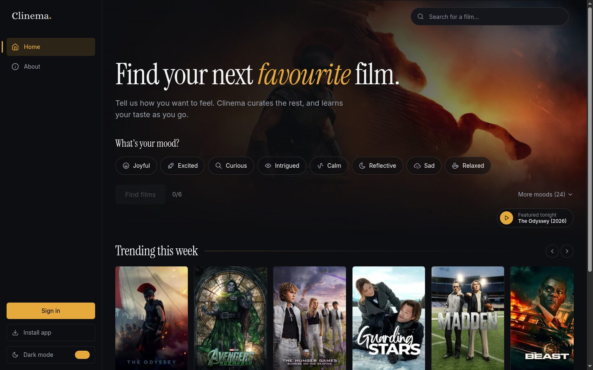
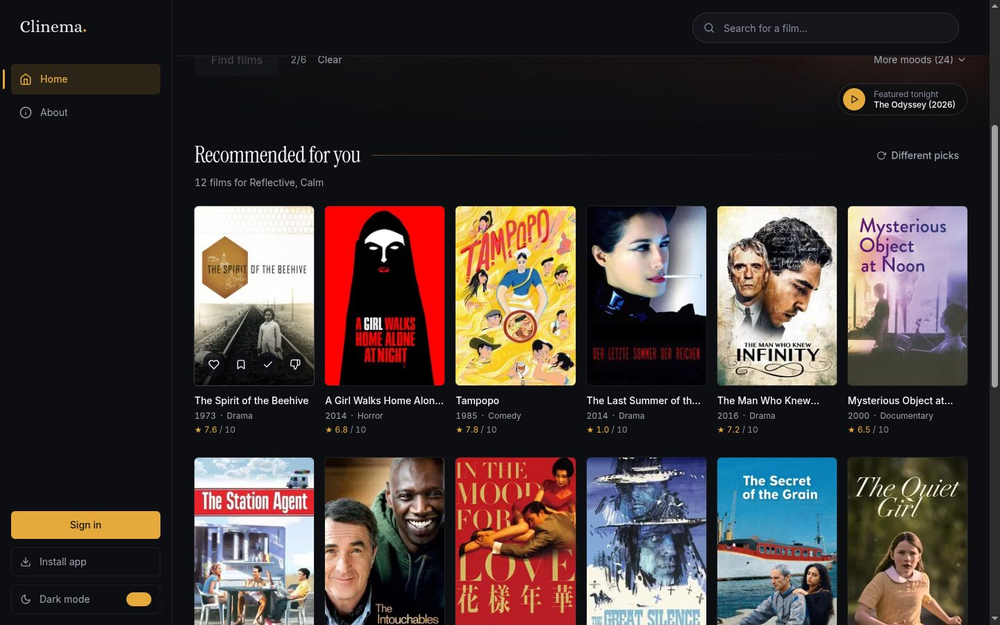
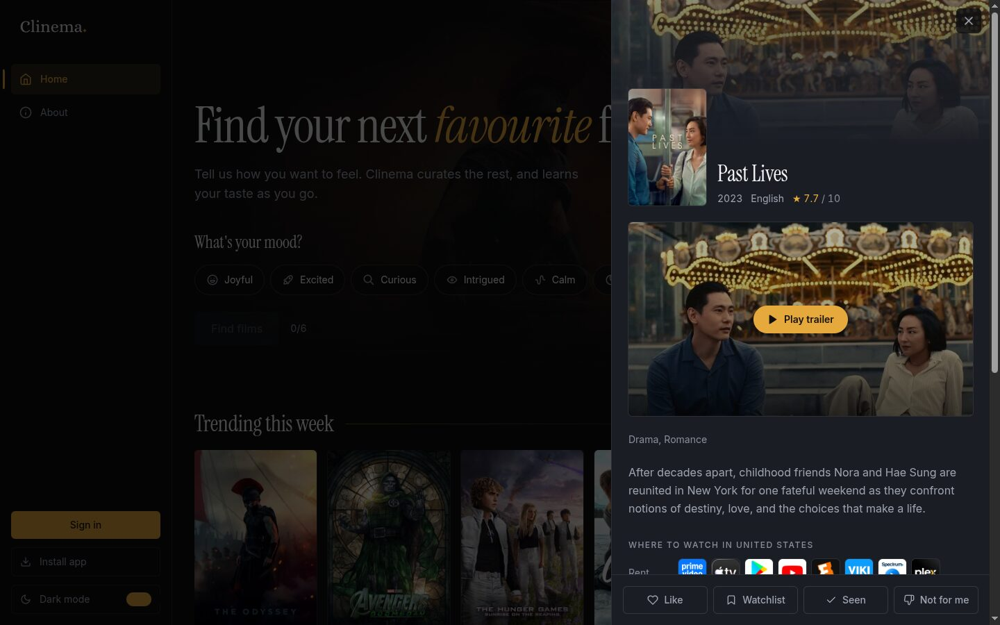
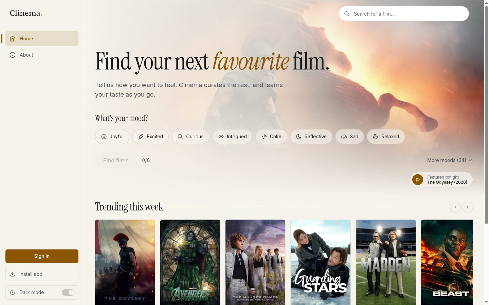
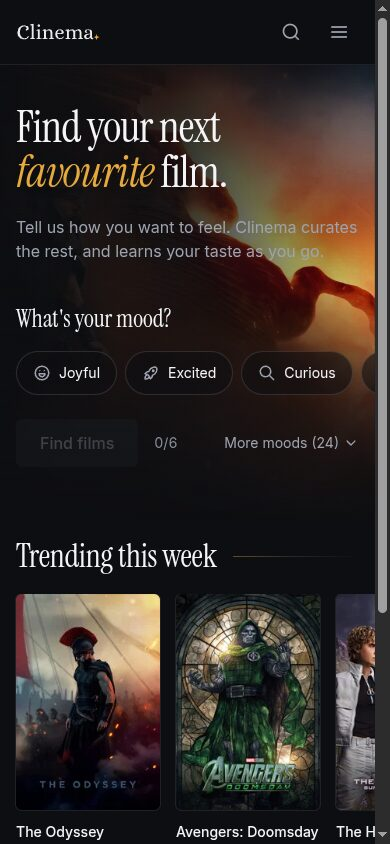
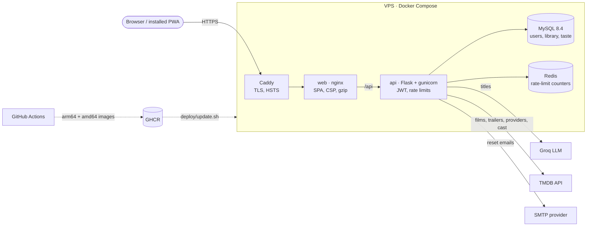

<p align="center">
  
</p>

<p align="center">
  <strong>The right film for how you feel.</strong><br />
  AI recommendations from your mood that learn your taste, never repeat, and show you where to watch.
</p>

<p align="center">
  <a href="https://clinema.duckdns.org"><strong>Live demo →</strong></a>
</p>

<p align="center">
  <a href="https://github.com/Matsadura/Clinema/actions/workflows/ci.yml"></a>
  
  
  
  
  
  
  
  
</p>

<p align="center">
  
</p>

---

## Overview

Choosing a film is harder than watching one. **Clinema** asks how you want to feel and has an LLM curate
films that fit the moment, each matched against [TMDB](https://www.themoviedb.org/) for posters, ratings,
trailers, cast and streaming availability. As you like, save, dismiss and open films, Clinema learns your
taste and personalises every list, and it never shows you the same film twice.

Clinema started as a hackathon project and has since been taken to production: it runs at
**[clinema.duckdns.org](https://clinema.duckdns.org)** on a 1 GB arm64 VPS behind Caddy (automatic HTTPS),
with CI-built images, nightly backups and uptime checks.

| Recommendations | Film details |
|---|---|
|  |  |
| **Light theme** | **Mobile** |
|  |  |

## Features

**Discover**
- 🎭 **Mood matching:** pick up to six of 24 moods, from *Joyful* to *Reflective*.
- 🤖 **AI curation that degrades gracefully:** an open-weight model on Groq (GPT-OSS 120B, falling back to
  20B) suggests films in 2–6 seconds. If the AI is slow, rate-limited or down, Clinema switches models
  instantly or falls back to TMDB discovery, so there are always results.
- 🔁 **Never the same list twice:** everything you've been shown, opened, liked, dismissed, saved or seen
  is excluded, both in the prompt and after generation.
- 🔎 **Search, trending and history:** search any film, browse this week's trending films, and review your
  activity grouped by day.

**Decide**
- ▶️ **Trailers in place:** play the trailer inside the film's details, without leaving the site
  (privacy-enhanced YouTube, loaded only when you press play).
- 📺 **Where to watch:** streaming, rental and purchase options for your country (from your browser's
  locale), from JustWatch via TMDB.
- 🎬 **Cast, crew and "More like this":** browse the cast, open any actor's or director's page with their
  films, and hop to similar films in the same drawer.
- 💬 **"Why this pick":** every AI suggestion explains how it fits your mood and your taste.

**Keep**
- 🧠 **Learns your taste:** likes (+2), dislikes (−2), saves (+1), seen (+0.5) and opened details (+0.5)
  build a time-decayed profile (genres, directors, themes, eras, languages, tone) that steers every prompt.
- ❤️ **Library:** likes, a watchlist, films you've seen and a "Not for me" list.
- 🔗 **Shareable watchlists:** publish a read-only link to your watchlist (first name only) and revoke or
  reset it at any time.
- 🔐 **Accounts:** JWT auth, salted PBKDF2 hashing, password reset by email (single-use, one-hour links that
  sign out every other session), profile editing and account deletion.
- 🔑 **Bring your own API keys:** plug in your own Groq and TMDB keys; they're verified, encrypted at rest
  and fall back to the server's keys automatically.

**Everywhere**
- 📱 **Installable app (PWA):** add Clinema to your home screen; the app shell works offline.
- 🌗 **Dark and light themes**, both WCAG AA, with keyboard navigation, focus-managed dialogs and
  reduced-motion support.
- ⚡ **Fast:** Lighthouse 100 for accessibility, best practices and SEO on mobile and desktop
  (performance 96 mobile, 100 desktop), with self-hosted fonts, responsive TMDB images and code splitting.

## Architecture



**Recommendation pipeline** (`server/api/services/`):

1. **Validate** the moods against a strict allow-pattern (prompt-injection hardening).
2. **Context** (`taste.py`): load the user's persisted taste profile and build a hard exclusion set. The set
   covers films recommended in the last 30 days plus everything viewed, liked, disliked or saved; guests send
   `seen_ids` from the browser instead.
3. **LLM** (`llm.py`): one fresh, uncached generation. The prompt carries the vibe, a compact taste summary
   (or a cold-start note), the exclusion list, anti-blockbuster rules and two randomly chosen diversity
   constraints. Output follows a strict JSON schema (`title, year, genres, director, country, tone,
   mood_fit, personalized_reason`). Sampling uses temperature 0.85 with frequency and presence
   penalties; models that reject a parameter are retried without it. A circuit breaker and a model fallback
   list protect against outages.
4. **Screen and resolve** (`recommender.py`): drop excluded titles (normalised), repeat directors and all but
   one over-exposed staple. Resolve on TMDB in parallel and drop excluded TMDB ids. If fewer than eight survive and time
   allows, run one more round with the rejected titles excluded; otherwise backfill from TMDB `discover`, preferring genres you like and
   leaving out ones you dislike.
5. **Learn:** shown films are logged as `recommended`. Likes, dislikes, saves and opened details are logged
   with weights, enriched with TMDB director and keywords, and folded into the profile straight away.

| Directory | Contents |
|---|---|
| `client/` | React 18 SPA (Vite, Tailwind, React Router). `src/lib/api.js` is the single network layer. |
| `client/e2e/` | Playwright end-to-end tests. |
| `client/nginx.conf` | Production web server: SPA routing, `/api` proxy, caching, security headers. |
| `server/api/` | Flask app factory, routes (`views/`) and external integrations (`services/`). |
| `server/models/` | SQLAlchemy models and the storage engine. |
| `server/migrations/` | Alembic migrations, applied automatically on startup. |
| `server/tests/` | Pytest suite. External APIs are mocked, and the database is in-memory SQLite. |
| `e2e/fake_upstreams.py` | Deterministic fake TMDB and Groq used by the end-to-end stack. |
| `deploy/` | Caddyfile, backup and update scripts for a VPS ([DEPLOY.md](DEPLOY.md)). |
| `docker-compose*.yml` | Production stack (`web`, `api`, `db`, `redis`), plus dev and E2E overrides. |

## Getting started

### Prerequisites

You need free API keys from [Groq](https://console.groq.com/keys) and
[TMDB](https://www.themoviedb.org/settings/api).

```bash
git clone https://github.com/Matsadura/Clinema.git
cd Clinema
cp .env.example .env      # then fill in the keys and passwords
python3 -c "import secrets; print(secrets.token_hex(32))"   # paste as JWT_SECRET_KEY
```

### Option A: Docker (recommended)

Requires Docker with Compose v2.

```bash
docker compose up -d --build
docker compose ps          # wait until all services are "healthy"
```

Open **http://localhost:8080**. Set `WEB_PORT` in `.env` to use a different port.

Useful commands:

```bash
docker compose logs -f api               # follow API logs
docker compose down                      # stop (data persists in the db_data volume)
docker compose down -v                   # stop and delete the database volume
```

### Option B: Local development

Requires Python 3.10+ and Node 20.19+. Start only MySQL in Docker:

```bash
docker compose -f docker-compose.yml -f docker-compose.dev.yml up -d db
```

Run the API (port 5000):

```bash
cd server
python3 -m venv .venv && source .venv/bin/activate
pip install -r requirements-dev.txt
python -m api.app
```

Run the client (port 5173, which proxies `/api` to the Flask server):

```bash
cd client
npm ci
npm run dev
```

> Prefer no MySQL at all? Set `DATABASE_URL=sqlite:///clinema.db` before `python -m api.app`.

### Environment variables

All configuration lives in a single root `.env` (see [`.env.example`](.env.example)).

| Variable | Required | Description |
|---|---|---|
| `GROQ_API_KEY` | ✅ | Groq API key (without it, Clinema uses the TMDB genre fallback only) |
| `TMDB_API_KEY` | ✅ | TMDB v3 API key |
| `JWT_SECRET_KEY` | ✅ | ≥ 32 random characters. Startup fails in production without it. |
| `KEY_ENCRYPTION_KEY` | Recommended | Fernet key(s) that encrypt users' own API keys, comma-separated with the newest first for rotation. If unset, a key is derived from `JWT_SECRET_KEY`, so rotating the JWT secret would invalidate saved user keys. |
| `MYSQL_PASSWORD`, `MYSQL_ROOT_PASSWORD` | ✅ (Docker) | Database credentials |
| `MYSQL_DATABASE`, `MYSQL_USER` | | Default to `clinema` |
| `APP_ENV` | | `production` (default in compose) or `development` |
| `GROQ_MODEL` | | Comma-separated models in order of preference (default `openai/gpt-oss-120b,openai/gpt-oss-20b`). Retired models are skipped automatically. |
| `LLM_TIMEOUT` | | Seconds before falling back (default `20`) |
| `JWT_EXPIRES_HOURS` | | Token lifetime (default `24`) |
| `CORS_ORIGINS` | | Comma-separated origins. Only needed if the SPA is hosted on another domain. |
| `DATABASE_URL` | | Full SQLAlchemy URL that overrides the `MYSQL_*` settings |
| `RATELIMIT_STORAGE_URI` | | Rate-limit storage (compose uses its bundled Redis) |
| `WEB_PORT`, `WEB_BIND` | | Host port and interface for the web container (default `0.0.0.0:8080`) |
| `TRUSTED_PROXIES` | | Proxy hops in front of the API (default `1`; `2` behind Caddy) |
| `SMTP_HOST`, `SMTP_PORT`, `SMTP_USERNAME`, `SMTP_PASSWORD`, `SMTP_SECURITY`, `MAIL_FROM`, `APP_URL` | | Outgoing email for password reset (see [DEPLOY.md](DEPLOY.md)); unset disables it |
| `API_IMAGE`, `WEB_IMAGE` | | Use CI-published images instead of building locally |

### Database migrations

The schema is managed with Alembic and upgraded automatically when the API starts. Databases created by
earlier releases are adopted without data loss. Run these from `server/`:

```bash
alembic upgrade head                                  # apply
alembic downgrade -1                                  # revert the latest migration
alembic revision --autogenerate -m "describe change"  # after editing models
alembic check                                         # verify models and migrations agree
```

## Testing and quality

```bash
cd server && pytest                       # 144 API, service and pipeline tests (no network needed)
cd server && pycodestyle api models tests
cd client && npm test                     # 66 Vitest + Testing Library tests
cd client && npm run lint && npm run build
```

**End-to-end:** Playwright drives the real Docker stack (web, API, MySQL, Redis) with TMDB and Groq replaced
by a local fake, so it needs no keys or network:

```bash
docker compose -f docker-compose.yml -f docker-compose.e2e.yml up -d --build --wait
cd client && npx playwright install chromium && npm run test:e2e
docker compose up -d --wait               # back to the normal stack afterwards
```

CI runs all of the above on every push and pull request, then publishes multi-arch images on `main`.

## API

The API is documented in [`server/api/README.md`](server/api/README.md). Key endpoints:

| Method | Path | Description |
|---|---|---|
| `GET` | `/api/health` | Readiness probe (checks the database) |
| `POST` | `/api/suggestions` | `{moods, seen_ids?}` → movies |
| `POST` | `/api/register` · `/api/login` | Account creation and JWT login |
| `GET` | `/api/<user_id>/library` | Liked and saved films, with details |
| `PUT` | `/api/<user_id>/library/<tmdb_id>` | Set `{like?, save?, dislike?, seen?}` |
| `GET` | `/api/movies/search?q=` · `/api/movies/trending` | Title search · this week's trending films |
| `GET` | `/api/<user_id>/history` | Recent activity per film |
| `POST` | `/api/<user_id>/interactions` | Log a view `{movie_id}` |
| `GET` | `/api/<user_id>/taste` | Learned taste profile and its prompt summary |
| `GET` | `/api/<user_id>/api-keys` | Which providers use the user's own key (masked) |
| `PUT` / `DELETE` | `/api/<user_id>/api-keys/<provider>` | Verify and save, or remove, a user key (`groq`, `tmdb`) |
| `GET` | `/api/movies/<id>/trailers` | YouTube trailers and teasers, best first |
| `GET` | `/api/movies/<id>/extras?region=XX` | Where to watch, cast and similar films |
| `GET` | `/api/people/<id>` | A cast or crew member and their films |
| `GET` / `PUT` | `/api/<user_id>/watchlist/share` | Watchlist sharing status · `{enabled, rotate?}` |
| `GET` | `/api/shared/<share_id>` | Public, read-only shared watchlist |
| `POST` | `/api/password/forgot` · `/api/password/reset` | Email a reset link · set a new password |
| `GET` | `/api/features` | Optional features this server has enabled |

## Bring-your-own API keys

- **Resolution:** each request builds an ordered list of keys per provider: the signed-in user's key first (if
  saved and not rejected), then the server's. The TMDB and LLM services try them in order, so a missing,
  revoked or rate-limited user key falls back without the user noticing.
- **Rejections:** a key the provider rejects (401/403) is marked `invalid`, stops being tried, and is flagged on the
  profile page so the user can replace it.
- **Isolation:** Groq clients, circuit breakers and unavailable-model tracking are kept per key (by a hashed
  fingerprint), so one user's key is never used for anyone else, and a broken key can't disable AI for others.
- **Logs:** API keys are redacted from upstream error messages before logging.

## Deployment

[DEPLOY.md](DEPLOY.md) is a step-by-step guide for a small VPS without a paid domain: firewall and swap,
Docker, a free hostname (DuckDNS or sslip.io), automatic HTTPS with Caddy, password-reset email, nightly
backups, uptime monitoring, and updates from prebuilt images (`deploy/update.sh`).

Other options:
- **Managed platforms:** the `server/` and `client/` Dockerfiles are independent, so they can run as two services
  on Render, Fly.io, Railway or Cloud Run with a managed MySQL. Set `DATABASE_URL`, and set `API_UPSTREAM` on the
  web service to the API's internal URL. Also set `NGINX_RESOLVER` to that platform's DNS resolver (the default,
  `127.0.0.11`, is Docker's embedded DNS).
- Set `TRUSTED_PROXIES` to the number of proxies in front of the API so rate limiting sees real client IPs
  (`1` for the bundled nginx, `2` behind Caddy).

## Authors

- [Ali JBARI](https://github.com/ila36IX)
- [Badr ANNABI](https://github.com/Badr-Annabi)
- [Karim ASSIHOUT](https://github.com/ashtkarim)
- [Oumaima NAANAA](https://github.com/naanaa59)
- [Radouane ABOUNOUAS](https://github.com/RadouaneAbn)
- [Zidane ZAOUI](https://github.com/matsadura)

Movie data is provided by [TMDB](https://www.themoviedb.org/). This product uses the TMDB API but is not endorsed
or certified by TMDB.
